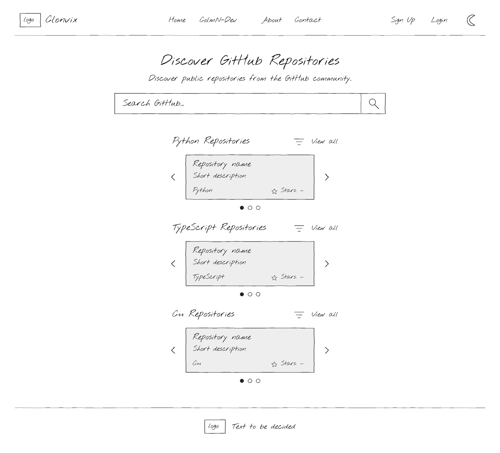
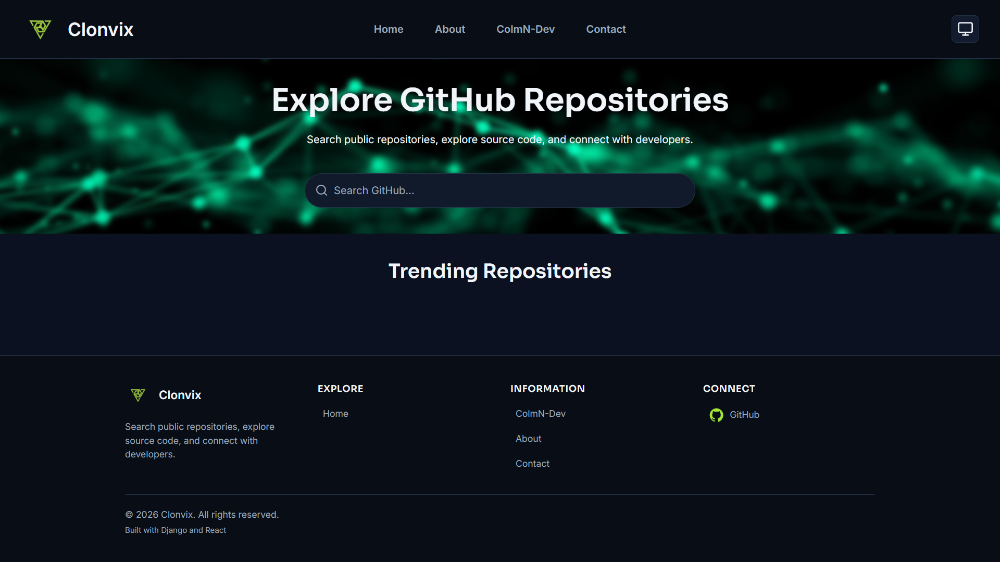
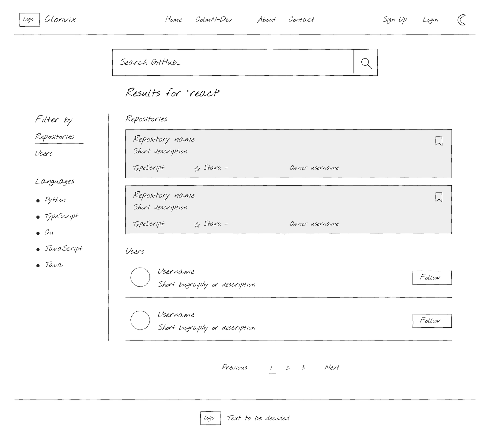
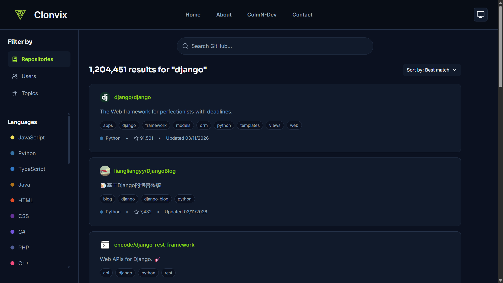
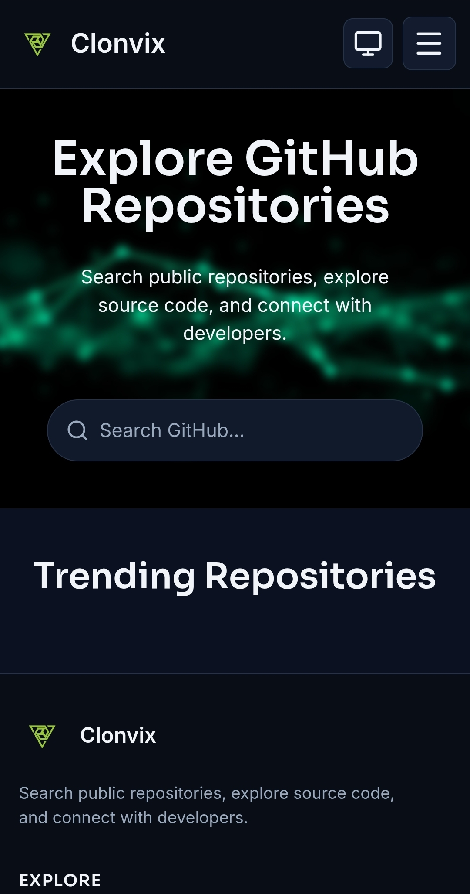
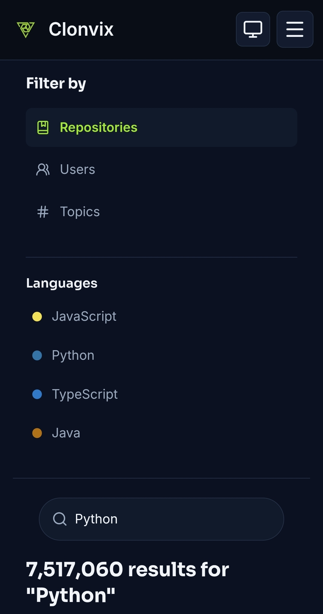

# Presentation 4 — Project Update

## Before-After Comparisons

### Homepage

- Original wireframe included three repository carousels
- Changed the planned layout to a 2x5 grid of trending repositories
- Grid layout avoids unnecessary carousel complexity and provides a simpler way to browse repositories
- Other layout and styling refinements were made during implementation

 

  
  

 

---

### Search Results

- Original wireframe showed an early design for repository and user search results
- Repository cards now show more information, including owner details, language, stars and topics
- Topic filter added to search results
- Footer expanded with useful links and additional information
- Follow and save buttons still to be added once authentication is implemented

 

  
  

 

### Profile Page

Due to time constraints during development, I was unable to implement the GitHub and Clonvix profile pages.

## Feature Highlights with Demos

### Repository Search

- GitHub API integrated with Django REST Framework
- Search requests handled by the backend rather than directly from React
- Repository results displayed with owner details, descriptions, languages, stars and topics
- Search results support topic filtering
- Pagination allows users to navigate through multiple pages of search results.

### Sorting and Filtering

- Repository sorting handled through the GitHub API
- Language and topic filters available
- Search results update based on selected filters

### Theme Support

- System, Light and Dark themes available
- Theme preference applied across the application
- CSS variables used to maintain consistent styling

### Deployment

- React frontend and Django backend deployed together on Render
- Neon PostgreSQL configured for production
- Application accessible at [Clonvix](https://clonvix.onrender.com)

### Demo

A live demonstration of the working application will follow the presentation.

## Integration and Compatibility Testing

### Integration Testing

| Area | What was tested | Result |
|---|---|---|
| React and Django | Frontend requests to backend API and handling of responses | Working |
| Django and GitHub API | Repository, user and topic search requests and responses | Working |
| Search functionality | Searching across repositories, users and topics using different queries | Working |
| Filtering | Repository language filters and applying filters to search results | Working |
| Sorting | Sorting search results using the available sorting options | Working |
| PostgreSQL | Database connection and application configuration | Connection working; limited database functionality tested |
| Render deployment | Application deployment and serving the React frontend through Django | Working |
| Theme support | System, Light and Dark theme behaviour | Working |

### Compatibility Testing

- Checked application layout across desktop and mobile screen sizes.
- Tested navigation and the mobile hamburger menu.
- Checked light and dark themes across application pages.
- Tested search result cards and layouts for repositories, users and topics.
- Checked filtering and sorting controls across different search queries.
- Tested empty search results and loading and error states.

 

  
  

 

### Issues Identified and Development Challenges

- **GitHub API limitations:** API restrictions affected the data and functionality available to the application. For example, repository star counts can be displayed, but accessing the repository's stargazers page is not supported.

- **User search data:** The GitHub user search endpoint provides limited information. An additional request to the individual user's endpoint was required to retrieve the metadata needed to display complete user cards.

- **API integration and UI rendering:** The frontend and backend logic had to be adapted to work with the data returned by GitHub, including handling missing fields and displaying only the information available.

- **GitHub API rate limits:** Search requests may be temporarily restricted when API rate limits are reached. Server-side caching was implemented to reduce repeated API requests and help minimise the impact of these limits.

- **Database integration:** PostgreSQL connectivity was established, but database functionality has not yet been a major focus of development.

## Feedback Action Report

### Feedback Received

- Suggested adding an interactive walkthrough to the homepage using tooltips to highlight key sections and explain the application's features.

### Action Taken

- Walkthrough feature identified as a potential usability improvement.
- Not yet implemented due to prioritising core application functionality and development tasks.
- Planned for implementation as a final usability enhancement.

## Final Stretch Plan

### Remaining Development

- Finish repository detail page and remaining search functionality.
- Implement user authentication and account management.
- Integrate GitHub OAuth for connecting developer accounts.
- Implement repository saving and developer following.
- Complete transactional email functionality for password resets and contact enquiries.
- Consider adding an interactive homepage walkthrough using tooltips.

### Testing and Refinements

- Test completed features and their integration across the frontend and backend.
- Test authentication, account management and database functionality.
- Check application responsiveness across desktop and mobile devices.
- Resolve any outstanding bugs or usability issues.
- Review error handling and API rate-limit behaviour.

### Final Submission Preparation

- Complete project documentation and update screenshots.
- Review code structure and remove unnecessary or unused code.
- Verify production deployment and environment configuration.
- Complete final project submission.